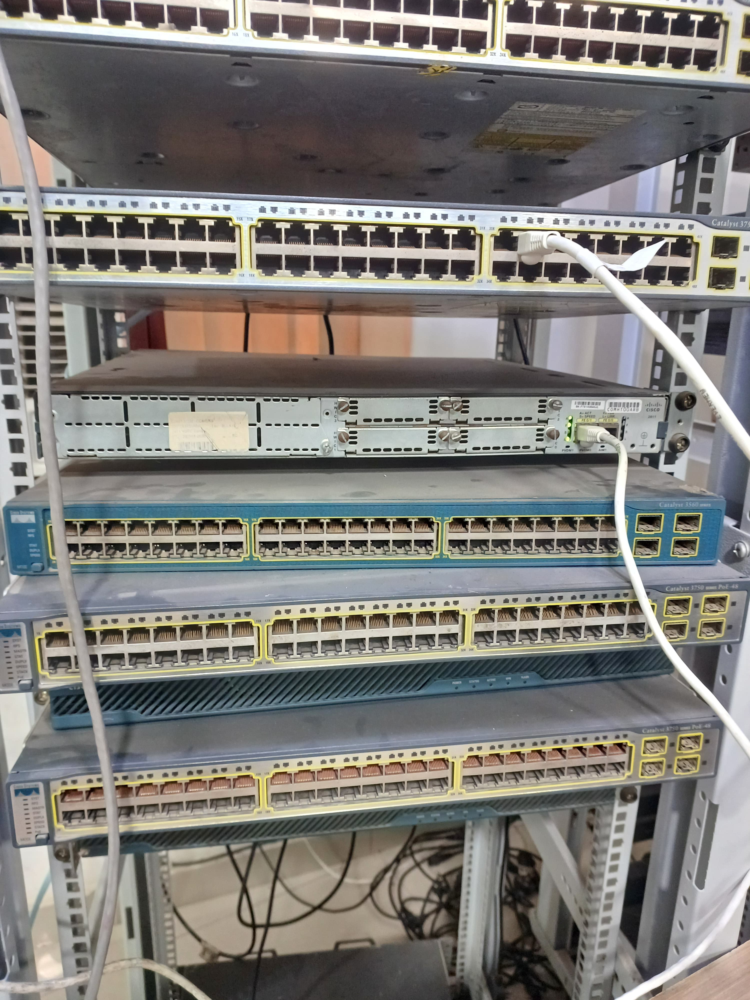
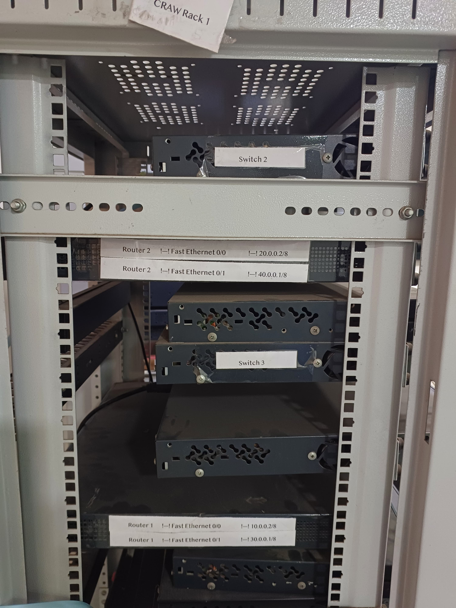
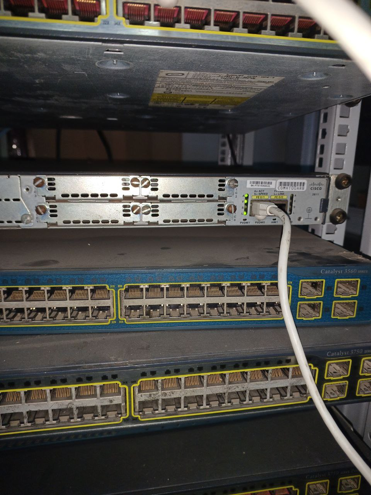
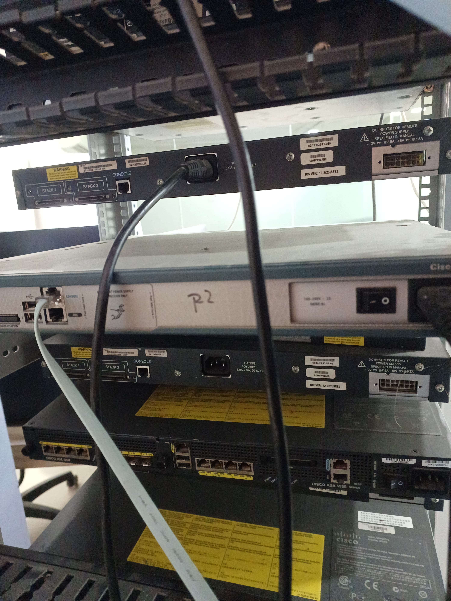
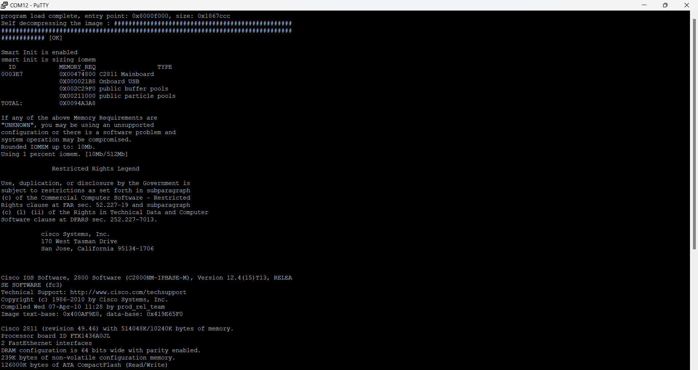
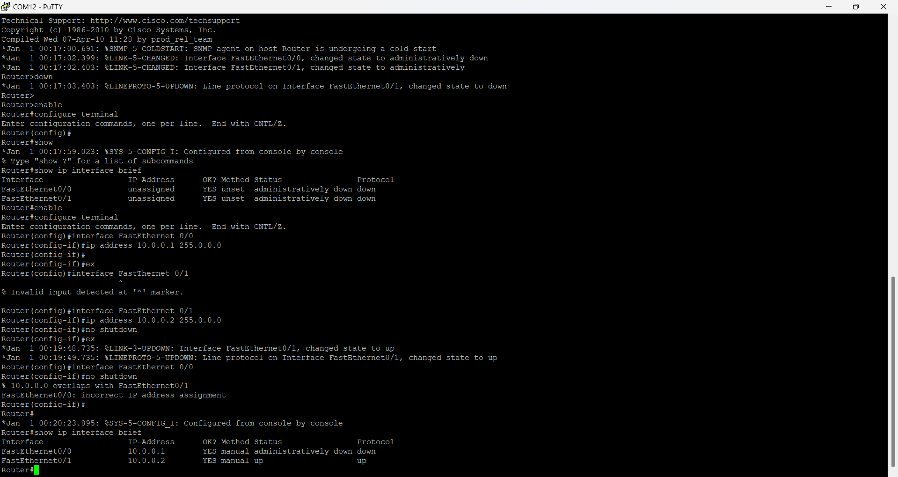

# Cisco Enterprise Network — Hands-On Hardware Lab

> Configuring real Cisco **2811 routers**, **Catalyst switches**, and network services on physical lab hardware — interface addressing, VLANs and inter-VLAN routing, DHCP/DNS, secure remote access (SSH), and Layer 2/Layer 3 troubleshooting with ARP and ICMP.


T13-blue)


<p align="center">
  
  <br>
  <em>Live console session — configuring the Cisco 2811 over serial (PuTTY) against CRAW Rack 1.</em>
</p>

---

## Overview

This repository documents a **hands-on networking lab performed on physical Cisco equipment** (not a simulator). Using a serial rollover cable and PuTTY, each device was consoled into and configured from the CLI to build and verify an end-to-end routed and switched network.

The lab covers the core competencies expected of a CCNA-level network engineer:

- **Router & switch bring-up** — interface addressing, `no shutdown`, status verification
- **Layer 2 switching** — VLAN creation, access/trunk ports, 802.1Q trunking
- **Layer 3 routing** — inter-VLAN routing (router-on-a-stick) and static routing between networks
- **Network services** — DHCP pools for automated IP allocation, DNS name resolution
- **Secure management** — SSH for encrypted remote access, with Telnet used for reachability testing
- **Troubleshooting & analysis** — ARP table inspection, ICMP (ping) diagnostics, interface state analysis

> **Environment:** The lab was conducted on the *CRAW Rack 1* equipment rack during CCNA training at Craw Security. Device configurations in this repository are reconstructed from the live console sessions and the physical interface labels captured during the lab, and are presented as a clean, reproducible reference.

---

## Repository structure

```
.
├── README.md                     # This file
├── LICENSE
├── .gitignore
│
├── docs/                         # Technical write-ups
│   ├── 01-project-overview.md        # Goals, scope, skills demonstrated
│   ├── 02-lab-topology.md            # Logical & physical topology
│   ├── 03-ip-addressing-scheme.md    # Addressing plan & subnet table
│   ├── 04-hardware-inventory.md      # Rack hardware & console setup
│   └── 05-verification-and-troubleshooting.md  # show commands, ARP/ICMP
│
├── configs/                      # Cisco IOS device configurations
│   ├── router1/
│   │   └── R1-running-config.txt
│   ├── router2/
│   │   └── R2-running-config.txt
│   ├── switches/
│   │   ├── SW-vlan-access-trunk.txt
│   │   └── inter-vlan-routing.txt
│   ├── services/
│   │   ├── dhcp-server.txt
│   │   ├── dns-resolution.txt
│   │   └── ssh-secure-access.txt
│   └── firewall/
│       └── asa5520-baseline.txt
│
├── diagrams/
│   └── topology.md               # ASCII + Mermaid topology diagrams
│
└── media/                        # Evidence from the live lab
    ├── console/                  # PuTTY console captures
    └── rack/                     # Physical rack & device photos
```

---

## Network at a glance

| Device   | Interface        | IP Address   | Mask        | Role                          |
|----------|------------------|--------------|-------------|-------------------------------|
| Router 1 | FastEthernet 0/0 | `10.0.0.2`   | `/8`        | LAN A gateway / core link     |
| Router 1 | FastEthernet 0/1 | `30.0.0.1`   | `/8`        | LAN C gateway                 |
| Router 2 | FastEthernet 0/0 | `20.0.0.2`   | `/8`        | LAN B gateway / core link     |
| Router 2 | FastEthernet 0/1 | `40.0.0.1`   | `/8`        | LAN D gateway                 |

Full addressing plan: [`docs/03-ip-addressing-scheme.md`](docs/03-ip-addressing-scheme.md)
Topology diagram: [`diagrams/topology.md`](diagrams/topology.md)

<p align="center">
  
  <br>
  <em>Source of the addressing plan — physical interface labels on Router 1 and Router 2.</em>
</p>

---

## Key skills demonstrated

| Domain | What was done |
|--------|---------------|
| **Device management** | Console access over serial (PuTTY), privileged EXEC, global config, saving `running-config` to `startup-config` |
| **IP connectivity** | Interface addressing, enabling interfaces, verifying with `show ip interface brief` |
| **Switching (L2)** | VLAN segmentation, access vs. trunk ports, 802.1Q trunking |
| **Routing (L3)** | Inter-VLAN routing (router-on-a-stick), static routes between `/8` networks |
| **Services** | DHCP address pools, excluded addresses, DNS name resolution |
| **Security** | SSH v2 with local auth, VTY line hardening, Telnet for connectivity testing |
| **Troubleshooting** | `show arp`, `ping` (ICMP), interface status, resolving IP overlap / `shutdown` issues |

---

## Hardware used

- **2 × Cisco 2811** Integrated Services Routers — IOS 12.4(15)T13 (`C2800NM-IPBASE-M`), 2 × FastEthernet
- **Cisco Catalyst 2960 / 3560 / 3750** series switches (Layer 2 & multilayer)
- **Cisco ASA 5520** adaptive security appliance
- **Console:** DB9-to-RJ45 rollover cable → USB serial adapter → PuTTY @ 9600 8N1 (COM12)

Full inventory & console settings: [`docs/04-hardware-inventory.md`](docs/04-hardware-inventory.md)

<p align="center">
  
  
  <br>
  <em>Left: Cisco 2811 + Catalyst 3560/3750 switches. &nbsp; Right: rack rear — routers, switches, and the ASA 5520.</em>
</p>

---

## Evidence

Live console captures and physical rack photos are in [`media/`](media/):

- **`media/console/`** — router boot / IOS version, system config dialog, interface addressing from the PuTTY session
- **`media/rack/`** — the physical rack (CRAW Rack 1), interface labels, and the live console session

<p align="center">
  
  
  <br>
  <em>Left: Cisco 2811 boot output — IOS 12.4(15)T13. &nbsp; Right: interface addressing and <code>show ip interface brief</code>.</em>
</p>

---

## How to use this repository

1. Read [`docs/01-project-overview.md`](docs/01-project-overview.md) for scope and objectives.
2. Review the topology and addressing in [`docs/02-lab-topology.md`](docs/02-lab-topology.md) and [`docs/03-ip-addressing-scheme.md`](docs/03-ip-addressing-scheme.md).
3. Walk the device configs in [`configs/`](configs/) — each file is a commented Cisco IOS configuration.
4. Follow the verification steps in [`docs/05-verification-and-troubleshooting.md`](docs/05-verification-and-troubleshooting.md) to reproduce the checks.

> The configurations are written to run on physical Cisco IOS devices but can also be adapted to **Cisco Packet Tracer**, **GNS3**, or **EVE-NG** for simulation.

---

## License

Released under the [MIT License](LICENSE). Documentation and lab configurations are provided for educational and reference purposes.
