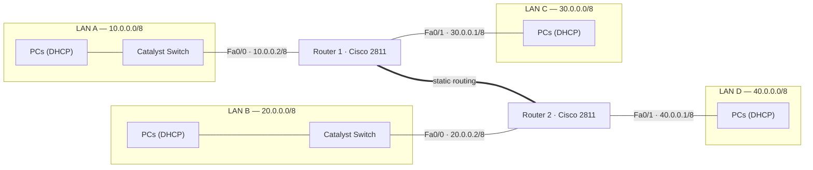
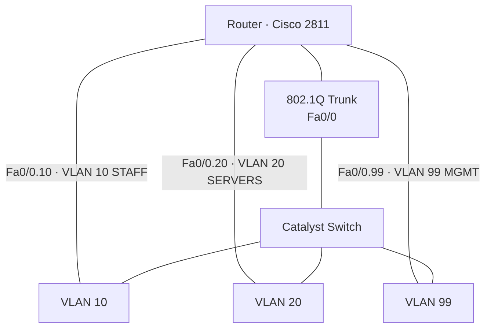

# Network Topology

## Logical diagram (Mermaid)



## Router-on-a-stick detail (inter-VLAN routing)



## ASCII reference

```
   LAN A (10.0.0.0/8)                     LAN B (20.0.0.0/8)
        |                                        |
   [Catalyst SW]                            [Catalyst SW]
        | Fa0/0 10.0.0.2/8                       | Fa0/0 20.0.0.2/8
   +----+-----+        static routing       +----+-----+
   | ROUTER 1 |===========================  | ROUTER 2 |
   +----+-----+                             +----+-----+
        | Fa0/1 30.0.0.1/8                       | Fa0/1 40.0.0.1/8
   LAN C (30.0.0.0/8)                     LAN D (40.0.0.0/8)
```

> Interface addressing is taken from the physical rack labels (`media/rack/01-craw-rack1-router-interface-labels.jpg`). See [`../docs/02-lab-topology.md`](../docs/02-lab-topology.md).
