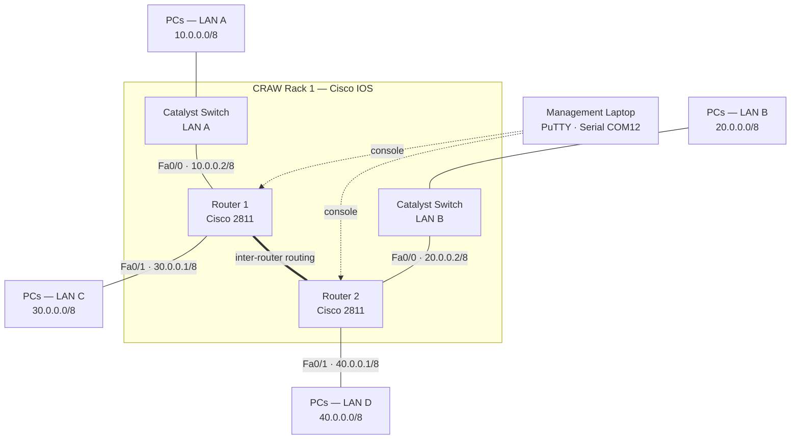

# 02 — Lab Topology

## Physical setup

All devices are mounted in the **CRAW Rack 1** equipment rack and connected as follows:

- A technician laptop running **PuTTY** connects to each device's **console (RJ45) port** through a DB9-to-RJ45 rollover cable and a USB-to-serial adapter (enumerated as **COM12** @ 9600 8N1).
- Router FastEthernet interfaces connect to Catalyst switches; switches provide access ports for end hosts (PCs).
- The two routers interconnect the four `/8` network segments and exchange traffic via routing.

## Logical topology (ASCII)

```
                            [ Management Laptop ]
                                   | (Console: serial / PuTTY, COM12)
                                   v
          +-----------------------------------------------------+
          |              CRAW Rack 1 (Cisco IOS)                |
          +-----------------------------------------------------+

   LAN A (10.0.0.0/8)                               LAN B (20.0.0.0/8)
        |                                                   |
   [ Catalyst SW ]                                     [ Catalyst SW ]
        | Fa0/0                                             | Fa0/0
        | 10.0.0.2/8                                        | 20.0.0.2/8
   +----+-----+                                        +----+-----+
   | ROUTER 1 |  Fa0/1: 30.0.0.1/8 ========= routing ==| ROUTER 2 |
   | Cisco2811|                                        | Cisco2811|
   +----------+                                        +----------+
        | Fa0/1                                             | Fa0/1
        | 30.0.0.1/8                                        | 40.0.0.1/8
   LAN C (30.0.0.0/8)                               LAN D (40.0.0.0/8)
        |                                                   |
     [ PCs ]                                             [ PCs ]
```

## Logical topology (Mermaid)



## Segments

| Segment | Network       | Gateway (router interface) |
|---------|---------------|-----------------------------|
| LAN A   | `10.0.0.0/8`  | R1 Fa0/0 — `10.0.0.2`       |
| LAN B   | `20.0.0.0/8`  | R2 Fa0/0 — `20.0.0.2`       |
| LAN C   | `30.0.0.0/8`  | R1 Fa0/1 — `30.0.0.1`       |
| LAN D   | `40.0.0.0/8`  | R2 Fa0/1 — `40.0.0.1`       |

> The `/8` masks (255.0.0.0) and segment assignments are taken directly from the physical interface labels documented on the rack (`media/rack/01-craw-rack1-router-interface-labels.jpg`).

## Traffic flow

1. End hosts in each LAN use their local router FastEthernet interface as the **default gateway**.
2. Routers forward inter-segment traffic according to their **routing tables** (connected + static routes).
3. Where a single switched segment carries multiple VLANs, the router performs **inter-VLAN routing** via 802.1Q sub-interfaces (see `configs/switches/inter-vlan-routing.txt`).

See the full plan in [`03-ip-addressing-scheme.md`](03-ip-addressing-scheme.md).
